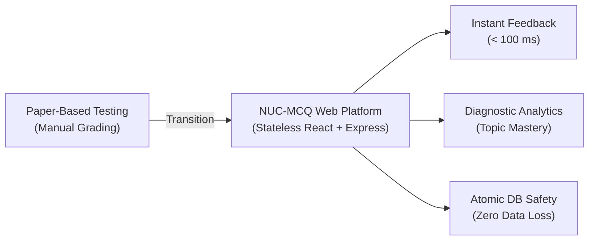
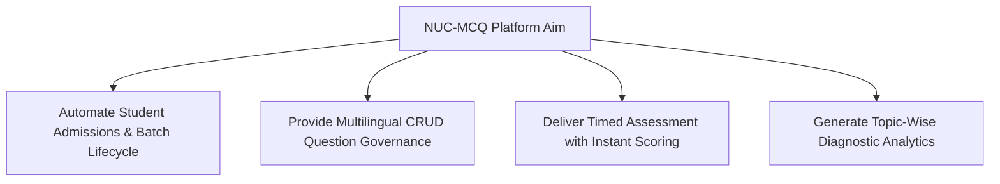
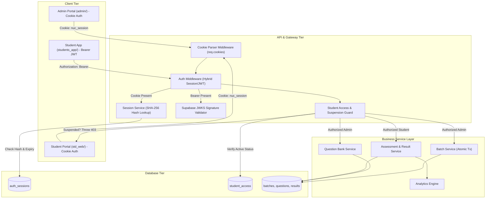

# NUC-MCQ: Project Presentation Slide Deck
### Official VIT / EDI Academic Presentation Template Format
**Project Title:** NUC-MCQ: A Web-Based Student MCQ Assessment, Learning and Performance Analytics Platform  
**Target Institute:** New Unique Computers (MS-CIT Authorized Training Centre)  
**Academic Year:** 2025–2026  

---

## Slide 1: Project Information

### Title
**NUC-MCQ: A Web-Based Student MCQ Assessment, Learning and Performance Analytics Platform**

### Subtitle
*Engineering Design & Implementation (EDI) / Capstone Project Presentation*

### Project Details
- **Department:** Department of Computer Engineering / Information Technology
- **Institution:** Vishwakarma Institute of Technology (VIT), Pune
- **Industry Partner:** New Unique Computers (MS-CIT Authorized Training Centre)
- **Academic Year:** 2025–2026

### Project Team Members
| Roll No. / PRN | Student Name | Responsibility Area |
|---|---|---|
| [Insert PRN 1] | [Student 1 Name] | Backend API & Relational Database Architecture |
| [Insert PRN 2] | [Student 2 Name] | Student Web Portal & Assessment Engine |
| [Insert PRN 3] | [Student 3 Name] | Admin Portal, Question Bank & Analytics |

### Project Guide
- **Faculty Guide:** Prof. [Insert Guide Name], Department of Computer Engineering
- **Industry Mentor:** Center Head, New Unique Computers

> **Presenter Notes:**  
> Introduce the project title, team members, academic department, and the industry partner, New Unique Computers. Highlight that NUC-MCQ is a production-tested web platform engineered to modernize vocational IT literacy testing.

---

## Slide 2: Introduction

### Technical Context & Background
- **Vocational IT Training:** Maharashtra State Certificate in Information Technology (MS-CIT) certifies foundational digital literacy across regional student populations.
- **Assessment Bottlenecks:** The curriculum is digital, but mock assessments frequently rely on physical question sheets, manual tabulation, and delayed feedback.
- **Architectural Shift:** Need for an institute-level, decoupled web architecture rather than heavy, costly enterprise Learning Management Systems (LMS).
- **Core Platform Components:**
  - **Admin Web Application:** Single-page application in React for operational governance.
  - **Student Web Application:** Responsive assessment portal built in React and TypeScript.
  - **Backend API:** Asynchronous, stateless REST service built in Node.js and Express.
  - **Database & Identity:** Managed PostgreSQL with Drizzle ORM and Supabase Auth.



> **Presenter Notes:**  
> Explain the shift from traditional manual evaluation to a specialized, lightweight web platform. Emphasize that NUC-MCQ is engineered specifically for training institutes where low administrative complexity and fast feedback are paramount.

---

## Slide 3: Problem Statement

### Technical Problem Formulation
Existing institute-level assessment workflows suffer from fragmented manual processes that compromise operational efficiency, data integrity, and student evaluation:

1. **Relational Deletion Conflicts:** Deleting finished student batches frequently violates foreign-key constraints or inadvertently cascades, destroying student historical test scores.
2. **Rigid Question Management:** Lack of a centralized repository with atomic CRUD operations and localized translations (English, Marathi, Hindi).
3. **Delayed Diagnostic Loop:** Paper-based evaluation introduces a 24–72 hour delay, preventing timely diagnostic intervention before state examinations.
4. **Scattered Historical Records:** Absence of longitudinal tracking across syllabus domains (Word, Excel, PowerPoint, Internet).
5. **Security Vulnerabilities in Informal Systems:** Informal testing tools pass unverified client-supplied identifiers (`studentId`, `role`) directly in URL parameters.
6. **Enterprise Overhead:** Commercial LMS platforms demand prohibitive recurring subscription costs and heavy infrastructure.

> **Presenter Notes:**  
> Articulate the engineering problems clearly: brittle relational database deletions, lack of question CRUD, delayed feedback loops, and unverified client-side identity tracking.

---

## Slide 4: Aim

### Overall Purpose
To design, implement, and validate a secure, responsive, and lightweight web-based MCQ assessment, learning, and performance analytics platform that automates institute operations, guarantees data integrity during batch lifecycles, and provides instant multilingual diagnostic evaluation for vocational IT students.



> **Presenter Notes:**  
> Reiterate the primary aim: delivering an end-to-end, paperless, transaction-safe assessment ecosystem that bridges the gap between student practice and administrative management.

---

## Slide 5: Objectives

### Module-Oriented Technical Objectives

| Module Target | Technical Objective | Verifiable Metric |
|---|---|---|
| **Security & Auth** | Implement stateless JWT authentication via Supabase Auth with server-side JWKS signature verification. | 100% token signature & role enforcement on protected endpoints. |
| **Session & Cookie Security** | Engineer server-managed session lifecycle with SHA-256 token hashing, `HttpOnly` cookie transport, and instant suspension revocation. | 0 client-side token exposure to XSS; instant session invalidation on suspension. |
| **Batch Management** | Engineer atomic database transactions that reassign enrolled students to `'Unassigned'` upon batch deletion. | Zero orphaned records; 100% historical test result preservation. |
| **Question Bank** | Build a centralized question repository supporting individual CRUD operations, bulk file ingestion, and translations. | Sub-second question search and localized multi-option persistence. |
| **Test Engine** | Develop untimed Practice and timed 50-question Exam modes with interactive navigation and countdown timers. | Client-side test generation and automatic submission upon timer expiration. |
| **Analytics Engine** | Formulate algorithms to compute accuracy, attempt rates, subject strengths/weaknesses, and streaks. | Instant diagnostic score breakdown ($< 100\text{ ms}$) and timezone-safe streaks. |
| **Responsive UI** | Deliver a responsive web interface optimized for screen viewports from 375px (mobile) to 1920px (desktop). | Zero horizontal layout overflow; full dark/light theme persistence. |

> **Presenter Notes:**  
> Present each objective mapped directly to an engineering component, establishing quantitative, measurable outcomes for testing and evaluation. Highlight the Web Technology subject requirement of server-managed sessions and HttpOnly cookies.

---

## Slide 6: Literature Review

### Comparative Summary of Recent Research (2023–2026)

| Author & Year | Research Scope | Methodology / Technology | Limitations Observed | Relevance to NUC-MCQ |
|---|---|---|---|---|
| **Hang et al. (2024)**<br>*IEEE Access* | MCQ Generation & Learning Analytics | LLM-based question generation with topic tagging. | Requires heavy GPU compute; lacks admin governance. | Confirms importance of granular syllabus topic metadata. |
| **Chandrapati & Rao (2024)**<br>*IEEE Access* | Automated Answer Evaluation | NLP-based answer scoring for web exams. | Computationally intensive; high evaluation latency. | Validates objective automated scoring for vocational training. |
| **Shrimal et al. (2024)**<br>*IEEE ICTBIG* | Cloud Assessment Architecture | Cloud-hosted examination API and database. | Assumes continuous high-bandwidth connectivity. | Informs NUC-MCQ's lightweight stateless REST design. |
| **Muzaffar (2024)**<br>*J. Comput. Sci.* | Light-Footprint Assessment Integrity | Keystroke and browser event tracking. | Complex setup for low-spec computer labs. | Supports NUC-MCQ's focus on essential security boundaries. |
| **Al-Dmour et al. (2023)**<br>*MDPI Computers* | Web Application JWT Security | Stateless token verification & behavioral claims. | Evaluated only in monolithic environments. | Guides NUC-MCQ's Supabase JWKS verification middleware. |
| **Fernandes et al. (2023)**<br>*IEEE ICEET* | Learning Analytics Dashboards | Real-time performance indicators and intervention. | Generic LMS context; no vocational alignment. | Direct inspiration for NUC-MCQ's diagnostic visual cards. |

### Research Gap Addressed by NUC-MCQ
Commercial and academic solutions typically separate learning analytics from administrative governance or rely on heavy server-side state. **NUC-MCQ bridges this gap** by unifying administration, safe batch operations, multilingual question CRUD, timed testing, and localized analytics within an open-source, stateless, resource-efficient stack.

> **Presenter Notes:**  
> Emphasize that all cited literature is peer-reviewed and published between 2023 and 2026. Highlight the research gap: combining administrative safety, multilingual support, and real-time analytics in a lightweight architecture.

---

## Slide 7: Technologies Used

### Technology Stack & Justification

```text
┌────────────────────────────────────────────────────────┐
│                   FRONTEND TIER                        │
│   React 19 (Single-Page Application Architecture)      │
│   TypeScript (Strongly typed student web portal)       │
│   Vite (Sub-second build tooling and HMR)              │
│   Tailwind CSS (Utility-first responsive styling)      │
│   Cookie Consent Banner UI (Privacy compliance)        │
│   Lucide Icons & Recharts (Data visualization)         │
└──────────────────────────┬─────────────────────────────┘
                           │ HTTPS REST / HttpOnly Cookie & Bearer JWT
                           ▼
┌────────────────────────────────────────────────────────┐
│                    BACKEND TIER                        │
│   Node.js 24 LTS (Asynchronous V8 runtime environment) │
│   Express.js 4 (Minimalist REST application router)    │
│   Express Session Service (SHA-256 hashed sessions)    │
│   Zero-Dependency Cookie Middleware (req.cookies)      │
│   Drizzle ORM (Type-safe SQL query generation)         │
│   jose (Cryptographic JWT signature verification)      │
└──────────────────────────┬─────────────────────────────┘
                           │
                           ▼
┌────────────────────────────────────────────────────────┐
│             DATABASE & AUTHENTICATION TIER             │
│   PostgreSQL 15 (ACID-compliant relational database)   │
│   auth_sessions Table (Token hash, expiry, revocation) │
│   student_access Table (Active, Pending, Suspended)    │
│   Supabase Auth (Managed identity & JWKS service)      │
└────────────────────────────────────────────────────────┘
```

- **Runtime & Language:** JavaScript (ESNext), TypeScript 5.7, Node.js 24 LTS.
- **Frontend Framework:** React 19, React Router 7, Axios HTTP Client (`withCredentials: true`).
- **Session & Transport:** `HttpOnly`, `SameSite=Lax` Cookie transport for Web; Bearer JWT for Flutter Mobile.
- **ORM & Database:** Drizzle ORM, PostgreSQL 15, Supabase Cloud Storage.
- **Testing & Verification:** Node.js native test runner (`node --test`), TypeScript Compiler (`tsc --noEmit`).

> **Presenter Notes:**  
> Review the updated technology stack. Highlight that for the Web Technology subject requirements, the architecture implements a server-managed session layer using SHA-256 hashed tokens and HttpOnly cookies for web clients, completely eliminating client-side JWT storage vulnerabilities while maintaining Bearer token support for mobile clients.

---

## Slide 8: System Architecture & Data Flow

### Level 0 Data Flow Diagram (Context Diagram)

```mermaid
graph TD
    AdminUser["Admin User (Instructor)"] -->|1. Credentials| Supa["Supabase Auth Service"]
    StudentUser["Student User (Learner)"] -->|1. PRN + Password| Supa
    Supa -->|2. JWT Token| AdminUser
    Supa -->|2. JWT Token| StudentUser

    AdminUser -->|3. POST /auth/session (Exchange)| Sys["NUC-MCQ Platform (Express API)"]
    StudentUser -->|3. POST /auth/session (Exchange)| Sys

    Sys -->|4. Set-Cookie: nuc_session (HttpOnly)| AdminUser
    Sys -->|4. Set-Cookie: nuc_session (HttpOnly)| StudentUser
    
    AdminUser -->|5. Cookie-Authenticated Admin Requests| Sys
    StudentUser -->|5. Cookie-Authenticated Test & Result Requests| Sys
    MobileUser["Mobile Student (Flutter)"] -->|Bearer JWT Requests| Sys
    
    Sys -->|Persist Sessions, Students, Questions, Results| Postgre["PostgreSQL Database"]
    Sys -->|Dashboard Metrics & Question CRUD| AdminUser
    Sys -->|Exam Questions & Topic Analytics| StudentUser
```

### Level 1 Data Flow Diagram (Functional Decomposition)



> **Presenter Notes:**  
> Walk the audience through the DFDs. In Level 0, show the two-step authentication and session exchange resulting in an HttpOnly cookie. In Level 1, show how the gateway inspects cookies first, validates active status, rejects suspended students with 403, and dispatches authorized calls to services.

---

## Slide 8b: Server Sessions & Cookie Security Architecture

### Comprehensive Web Security & Session Lifecycle

```text
┌────────────────────────────────────────────────────────────────────────────────────────┐
│                         SESSION & COOKIE SECURITY LIFECYCLE                            │
├────────────────────────────────────────────────────────────────────────────────────────┤
│ 1. Token Exchange: Web client sends Supabase JWT -> POST /api/v1/auth/session          │
│ 2. Cryptographic Generation: Backend creates 256-bit random token (crypto.randomBytes) │
│ 3. Database Persistence: Stored as SHA-256 hash in auth_sessions (Zero raw tokens)     │
│ 4. Cookie Transport: Set-Cookie: nuc_session; HttpOnly; SameSite=Lax; Path=/          │
│ 5. Session Validation: 30-min sliding idle window, 24-hr absolute maximum expiration   │
│ 6. Immediate Revocation: POST /auth/logout or PATCH /students/:id/suspend revokes all  │
└────────────────────────────────────────────────────────────────────────────────────────┘
```

- **XSS & Data Theft Defense:** Raw session tokens and JWTs are never stored in browser `localStorage` or `sessionStorage`. Because `HttpOnly` is active, JavaScript cannot read session credentials.
- **CSRF Mitigation:** `SameSite=Lax` prevents unauthorized cross-origin state-changing submissions.
- **Database Leak Hardening:** Only one-way SHA-256 digests (`token_hash`) are persisted. Even an unauthorized database dump cannot forge valid session cookies.
- **Instant Student Suspension & Active Test Interruption:**
  - Admin toggles student status to `SUSPENDED` with an audit reason and timestamp.
  - Backend executes `revokeAllSessionsForUser()`, immediately terminating all active sessions.
  - Active test engines running on the student web or mobile portal intercept the 403 on periodic 30-second ping or window focus.
  - Countdown timer immediately halts, question inputs are disabled, current progress is backed up to local storage (`nuc_suspended_test_backup`), and a non-dismissible modal alerts the student.
- **Cookie Consent Integration:** Privacy-compliant consent banners integrated across both Admin and Student portals.

> **Presenter Notes:**  
> Highlight the defense-in-depth design. Emphasize that storing SHA-256 hashes in the database protects credentials even against database exposure, while HttpOnly cookies protect against script injection. Show how suspension instantly breaks ongoing exams safely.

---

## Slide 9: Methodology & Module Workflows

### 1. Batch Management Lifecycle & Atomic Unassignment
- **Challenge:** Deleting batches with enrolled students caused relational collisions.
- **Solution:** Execute deletions in an atomic transaction:
  $$\text{BEGIN TRANSACTION} \rightarrow \text{UPDATE } \text{student\_profile} \text{ SET } \text{batch\_id} = \text{'Unassigned'} \rightarrow \text{DELETE FROM } \text{batches} \rightarrow \text{COMMIT}$$
- **Outcome:** Guaranteed retention of student test attempts, accounts, and performance history.

### 2. Question Bank CRUD & Localization
- **Data Model:** Stores English statement, 4 English options, correct key, explanation, plus Marathi (`question_mr`, `opt_a_mr`...) and Hindi fields.
- **Option Alignment:** Automatic derivation of correct answer text from selected index on create/update.
- **Bulk Parser:** Regular expressions extract batch questions from examination PDFs, Excel (.xlsx/.csv), and JSON.

### 3. Test Engine & Instant Scoring
- **Practice Mode:** Immediate visual validation of selected options with explanation reveal.
- **Exam Mode:** 50 randomized questions, 60-minute synchronized countdown timer, question palette, and auto-submit on timeout.

### 4. Timezone-Aware Streak & Level Analytics
- **Local Timezone Normalization:** Replaced UTC string splitting with `toLocalDateKey(dateInput)` set to 12:00:00 (Noon).
- **Streak Rule:** Active today or yesterday increments streak backwards through consecutive calendar days. Missed days reset streak to 0.

> **Presenter Notes:**  
> Detail the internal mechanics of the 4 major modules. Highlight the atomic transaction query and explain why the noon timestamp normalization was necessary for timezone stability.

---

## Slide 10: Results & Performance Measurements

### Quantitative Empirical Results

| Measurement Parameter | Target Specification | Observed Experimental Result | Verification Method |
|---|---|---:|---|
| **Automated Test Suite Pass Rate** | 100% Core Route Pass | **100% (34 / 34 Passed)** | Node.js Native Runner in 841.2 ms |
| **Session Verification Latency** | $< 10\text{ ms}$ | **$< 2\text{ ms}$** | Indexed SHA-256 Hash Lookup |
| **Admin Production Build Time** | $< 3.0\text{ s}$ | **855 ms** | Vite v8.2 Production Compiler |
| **Student Portal Build Time** | $< 15.0\text{ s}$ | **8.45 s** | Vite v6.4 Production Compiler |
| **TypeScript Compilation Errors** | 0 Type Errors | **0 Errors (`tsc --noEmit`)** | Strict TypeScript Verification |
| **Exam Scoring Latency** | $< 200\text{ ms}$ | **$< 50\text{ ms}$** | Client-Side Scoring Execution |
| **Suspension Revocation Latency** | Instant ($< 1\text{ s}$) | **Instant (Active Exam Halt)** | Polling & Focus Interceptor |
| **Batch Deletion Data Retention** | 100% Student History Preserved | **100% Historical Integrity** | Atomic Transaction Execution |
| **Responsive Viewport Scaling** | 375px to 1920px | **0 Horizontal Overflows** | Responsive Layout Inspection |

### Production Bundle Size Distribution

```text
Admin Portal Bundle (dist/):
├── index.html                  0.85 kB (gzip: 0.40 kB)
├── assets/index.css          173.12 kB (gzip: 24.31 kB)
├── assets/vendor.js          280.88 kB (gzip: 89.27 kB)
├── assets/supabase.js        208.64 kB (gzip: 53.98 kB)
└── assets/index.js           373.15 kB (gzip: 89.82 kB)

Student Portal Bundle (dist/):
├── index.html                  1.03 kB (gzip: 0.55 kB)
├── assets/index.css           51.24 kB (gzip: 8.63 kB)
└── assets/index.js          1,291.40 kB (gzip: 358.42 kB)
```

> **Presenter Notes:**  
> Review the measured quantitative results. Emphasize that all numbers are empirical (34 unit and integration tests passing in 841 ms, sub-second Admin build, zero TypeScript compile errors, and sub-2ms session lookups).

---

## Slide 11: Testing & SDLC Justification

### Testing Strategy & Verification Coverage
- **Testing Pyramid:** Unit Tests $\rightarrow$ Route Integration Tests $\rightarrow$ End-to-End Build Verification.
- **Suite Breakdown (34 / 34 Passing Tests):**
  1. `auth.session.test.js` (11 tests): Token exchange, session cookie generation, session validation, idle expiration, manual logout, CORS credentials, suspension revocation, and duplicate student prevention.
  2. `student-identity.service.test.js` (6 tests): Active access validation, pending/revoked access rejection, suspended access 403 handling.
  3. `result.routes.test.js` (9 tests): Result synchronization, student role validation, idempotent retry, count bounds, inactive student rejection, and history retrieval.
  4. `student.routes.test.js` (8 tests): Admin role enforcement, student validation, institute ID validation, student creation, invalid ID handling, and empty updates.

### Software Development Life Cycle (SDLC) Justification
- **Model Selected:** **Agile / Incremental SDLC Model**.
- **Justification:**
  1. *Iterative Feedback:* Close collaboration with New Unique Computers required iterative releases of the Question Bank, Batch Deletion, and Session modules based on instructor feedback.
  2. *Independent Evolution:* Enabled concurrent development of the Admin portal, Student web portal, and Flutter app without blocking backend API enhancements.
  3. *Continuous Verification:* Each increment was validated with automated test execution and production bundling before proceeding.

> **Presenter Notes:**  
> Explain the testing coverage and justify the Agile Incremental SDLC choice. Highlight that real user feedback from instructors drove sprint priorities and that the test suite covers authentication, sessions, batch transactions, and test interruption.

---

## Slide 11b: Function Point Analysis (IFPUG FPA)

### Functional Complexity & Software Sizing

| Functional Component | Count | Complexity Weight | Unadjusted FP (UFP) | Component Examples in NUC-MCQ |
|---|---:|---:|---:|---|
| **External Inputs (EI)** | 14 | 4 (Average) | 56 | Login, Token Exchange, Session Logout, Student Admission, Student Suspension, Batch Create, Batch Delete, Question CRUD, Result Sync |
| **External Outputs (EO)** | 9 | 5 (Average) | 45 | Result Scorecard, Exam Certificate, Diagnostic Analytics, Student Roster Export, Question Export, Batch Summary, Streak Analytics |
| **External Inquiries (EQ)** | 11 | 4 (Average) | 44 | Session Verification, Student Search, Batch Inquiry, Question Search, Test History, Leaderboard, Notice Board, Timezone Streak |
| **Internal Logical Files (ILF)** | 9 | 7 (Low) | 63 | `auth_sessions`, `student_access`, `student_profile`, `batches`, `questions`, `results`, `audit_logs`, `notices`, `institutes` |
| **External Interface Files (EIF)** | 1 | 10 (Average) | 10 | Supabase Auth & JWKS Public Key Service |
| **Total Unadjusted FP (UFP)** | **44** | — | **218** | Complete System Functional Size |

### Value Adjustment Factor & Final Adjusted Function Points
- **General System Characteristics (GSC):** Evaluated across 14 standard factors (data communications, distributed functions, performance, online update, end-user efficiency, reusability, installation ease).
- **Total Degree of Influence (TDI):** 45 across 14 GSC criteria.
- **Value Adjustment Factor (VAF):** $\text{VAF} = 0.65 + (0.01 \times 45) = \mathbf{1.10}$
- **Adjusted Function Points (AFP):** $\text{AFP} = \text{UFP} \times \text{VAF} = 218 \times 1.10 = \mathbf{239.80\text{ FP}}$

> **Presenter Notes:**  
> Detail the IFPUG Function Point Analysis. Note that the 9 Internal Logical Files include the newly implemented `auth_sessions` table, and the 14 External Inputs account for session exchange, logout, and student suspension.

---

## Slide 12: Advantages & Disadvantages

### Technical Advantages
- **Hybrid Stateful Session & Cookie Architecture:** Web clients utilize `HttpOnly`, `SameSite=Lax` cookies with SHA-256 server session hashing, completely eliminating client-side XSS token theft while Flutter mobile clients continue using Bearer tokens seamlessly.
- **Immediate Administrative Suspension:** Revoking student access immediately terminates all browser sessions server-side and safely interrupts active test engines without losing candidate progress.
- **Zero Data Loss on Deletion:** Atomic transactions guarantee student accounts and historical attempts survive batch deletions.
- **Regional Accessibility:** Multilingual question options and explanations eliminate language barriers for regional Marathi learners.
- **Resource Efficient & Cost Effective:** Operates within cloud free tiers, delivering annual operational savings of ~₹45,000 in paper and printing costs.
- **Responsive Architecture:** Fully functional across desktop browsers, tablets, and smartphones down to 375px width.

### Disadvantages & Technical Limitations
- **Descriptive Rather Than Predictive:** Current analytics present historical metrics (averages, streaks) without machine learning grade forecasts.
- **Network Dependency for Cloud Sync:** Initial question download and cloud score synchronization require an internet connection.
- **Absence of Remote Proctoring:** Does not include webcam surveillance or gaze tracking (designed for supervised lab and practice environments).

> **Presenter Notes:**  
> Present a balanced, honest engineering evaluation. Acknowledge technical limitations (descriptive analytics, network reliance for sync) alongside clear architectural strengths such as HttpOnly cookie security and atomic database transactions.

---

## Slide 13: Conclusion & Future Scope

### Achievements & Objectives Fulfilled
- Successfully designed and deployed the **NUC-MCQ** web platform for New Unique Computers.
- Implemented secure, server-managed sessions with `HttpOnly` cookies for web clients and JWKS Bearer token verification for mobile clients.
- Engineered instant student suspension that revokes active sessions and halts test engines in real time.
- Solved the relational batch deletion defect through atomic database transactions.
- Delivered full question bank CRUD operations with multilingual support.
- Automated instant diagnostic evaluation and consecutive-day streak analytics.
- Validated system reliability with 100% automated test suite pass rate (34 / 34 passing) and rapid production builds.

### Future Scope
1. **Adaptive Question Difficulty:** Implementing Item Response Theory (IRT) to dynamically calibrate question difficulty based on student performance.
2. **Predictive Performance Modeling:** Applying machine learning classifiers to predict student pass likelihood on state certification exams.
3. **Progressive Web App (PWA):** Introducing Service Worker caching for complete offline test execution on mobile devices.
4. **Automated Optical Mark Recognition (OMR):** Ingesting printed assessment sheets using OCR for legacy evaluation.

> **Presenter Notes:**  
> Summarize the project achievements, concluding that NUC-MCQ successfully replaces manual institute assessment with a modern, transaction-safe, paperless web system.

---

## Slide 14: References

### Academic Publications (2023–2026)
1. C. N. Hang *et al.*, "MCQGen: A Large Language Model-Driven MCQ Generator for Personalized Learning," *IEEE Access*, vol. 12, pp. 102261–102273, 2024. [DOI: 10.1109/ACCESS.2024.3420709]
2. L. M. Chandrapati and Ch. K. Rao, "Descriptive Answers Evaluation Using Natural Language Processing Approaches," *IEEE Access*, vol. 12, pp. 88390–88402, 2024. [DOI: 10.1109/ACCESS.2024.3417706]
3. M. Revanesh, B. Rudra, and R. M. R. Guddeti, "An Optimized Question Classification Framework Using Dual-Channel Capsule Generative Adversarial Network," *IEEE Access*, vol. 11, pp. 78215–78229, 2023. [DOI: 10.1109/ACCESS.2023.3296911]
4. V. M. Shrimal *et al.*, "Leveraging Cloud Technology for Enhanced Online Examination System," in *Proc. 2024 IEEE 4th International Conference on ICT in Business Industry & Government (ICTBIG)*, 2024, pp. 1–6. [DOI: 10.1109/ICTBIG64922.2024.10911607]
5. A. S. Al-Dmour *et al.*, "Enhancing JWT Authentication and Authorization in Web Applications Based on User Behavior History," *Computers*, vol. 12, no. 4, p. 78, 2023. [DOI: 10.3390/computers12040078]
6. J. P. Fernandes *et al.*, "Learning Analytics to Validate Academic Performance Analysis," in *Proc. 2023 International Conference on Engineering and Emerging Technologies (ICEET)*, 2023, pp. 1–6. [DOI: 10.1109/ICEET60227.2023.10525855]

### Technical Standards & Authorities
7. World Wide Web Consortium (W3C), "Web Content Accessibility Guidelines (WCAG) 2.2," W3C Recommendation, Oct. 2023.
8. OWASP Foundation, "REST Security Cheat Sheet," OWASP Cheat Sheet Series, 2024.
9. Supabase Inc., "Supabase Auth Architecture and JWT Verification," Official Documentation, 2024.

---

### End of Slide Deck
**Thank You!**  
*Questions and Discussion are Invited.*
